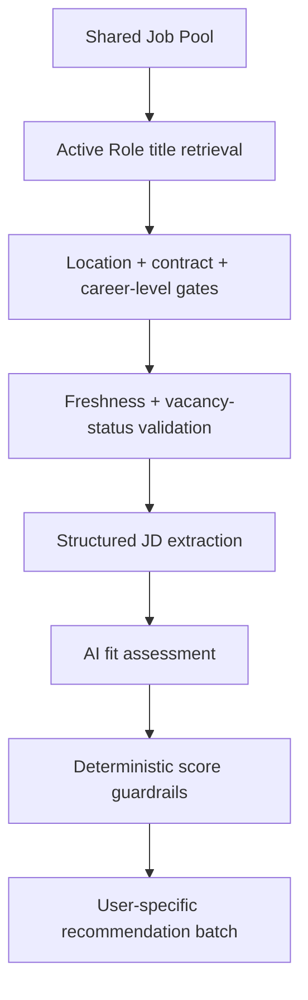

# Polaris Product Case Study

## 1. Context

Early-career job discovery has a sequencing problem. Platforms ask users to search for a job title before helping them understand which titles genuinely fit. CV-based recommendation tools often solve this by matching skills, but a shared skill does not mean shared daily work.

Polaris explores a different sequence:

> Understand the person → define realistic directions → discover relevant roles → validate real vacancies → explain fit.

The MVP was built for students and early-career professionals in France, initially around internships, graduate programmes and junior roles.

## 2. Product hypothesis

If users can recognise themselves in a concise Career Identity and refine the roles that follow from it, job recommendations should feel more relevant, understandable and actionable than keyword-only search.

Three principles shaped the product:

1. **Interpret, do not summarise.** Career Identity should reveal a professional pattern rather than retell a CV.
2. **Propose, then let the user refine.** AI recommendations are hypotheses, not permanent labels.
3. **Judge the work itself.** Core responsibilities matter more than generic transferable skills.

## 3. The user journey

### Preview

A static example lets first-time users understand the value before uploading a CV. It shows the complete product outcome — identity, directions and opportunities — without making an AI call or using real job data.

### Career input

The onboarding combines:

- CV and explicit career intent
- five situational work-style questions
- role, location, industry and contract preferences

Work-style answers influence how the profile is interpreted; they are not hard-coded to specific careers and never represent ability.

### Career Identity

The output is designed to be understood in roughly ten seconds:

- one concise archetype
- four memorable capability signals
- exactly three recognisable career directions

### Roles to Explore

AI-suggested roles and user-created roles have equal status once confirmed. Users can add free-text roles, remove recommendations and change the search scope without regenerating their identity.

### Opportunities

The product separates:

- **Recommended for you:** recent roles discovered across connected sources
- **From companies you follow:** relevant roles from selected company career pages

Each opportunity explains why it fits, what the work is really like, key considerations and possible next steps.

## 4. Matching architecture

The fit model uses five dimensions:

| Dimension | Weight |
| --- | ---: |
| Core work & motivation | 35% |
| Career direction | 25% |
| Transferable skills | 15% |
| Growth value | 15% |
| Environment & work style | 10% |

Deterministic guardrails can cap or remove a result when the model overlooks a critical qualification, specialist-profession barrier, academic requirement, major career pivot or core-work conflict.

## 5. Key product problems and iterations

### False positives from broad transferable skills

**Observed problem:** analytical ability made unrelated roles appear plausible.

**Change:** core work and career direction became dominant; specialist roles require direct evidence of the core capability.

**Product lesson:** adjacent potential should widen discovery, not override the actual job.

### Career directions that sounded personalised but were not searchable

**Observed problem:** outputs such as “Founder in AI-powered consumer applications” sounded specific but did not map cleanly to the employment market.

**Change:** directions now use broad, recognisable career families such as Product & Product Strategy or Strategy & Operations. Industry and technology interests shape reasoning without over-narrowing the direction.

### Stale jobs appearing fresh

**Observed problem:** an aggregator could update freshness metadata for an old job whose official application was already closed.

**Change:** vacancy validation prioritises the official career page and application status, then content dates, then source publication metadata. HTTP 200 alone is never treated as proof that a vacancy is open.

### Recommendations changing unexpectedly

**Observed problem:** page refreshes and partial source failures could make opportunities disappear.

**Change:** recommendations are immutable user-specific batches. New opportunities merge with still-valid results, while incomplete runs preserve the previous batch.

### One profile dominating product decisions

**Observed problem:** a system tuned around a Strategy/Product CV could appear personalised while serving similar roles to everyone.

**Change:** repeatable audits now test Strategy/Product, Marketing/FMCG, Finance/Investment and Supply Chain/Logistics separately. The audit traces losses through source collection, title retrieval, eligibility, freshness and AI scoring.

## 6. Privacy and beta measurement

The beta architecture uses anonymous invitation identities rather than a full account system. Each user has isolated profile, CV, Active Roles, followed companies, saved state, recommendation batches, sessions and feedback.

Analytics tables contain internal IDs and timestamps, not CV text, names, emails or full Career Identity content. The measurement plan focuses on:

- onboarding completion
- successful opportunity delivery
- satisfaction score
- return intention
- seven-day return behaviour

## 7. Validation approach

The current test strategy includes:

- parser regressions for French and English job descriptions
- title-taxonomy and alias coverage
- location, contract and early-career eligibility
- academic and experience-requirement guardrails
- recommendation stability and failure protection
- two-user data isolation
- multi-profile recommendation audits

More than 250 automated tests currently protect the MVP's core loop.

## 8. What I would measure next

For the first five-user beta, I would prioritise:

1. Can users complete onboarding and receive opportunities?
2. Do they recognise themselves in the Career Identity?
3. Are the recommended roles directionally right?
4. Is poor output caused by matching quality or by missing fresh jobs?
5. Do users return within seven days?

This keeps the next iteration focused on observed product constraints rather than adding features prematurely.

## 9. What this project demonstrates

- translating an ambiguous user problem into a clear product loop
- designing an AI system with user control and deterministic safeguards
- building a multi-source data product rather than a standalone prompt demo
- diagnosing recommendation quality with structured funnels
- treating privacy, stability and measurement as product requirements
- iterating from qualitative feedback into testable system behaviour

---

The public demo uses synthetic data. The operational codebase, credentials and user data remain private.
