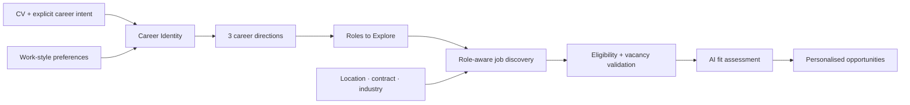

# Polaris — AI Career Discovery

> **A product case study in turning a CV into a career direction — and that direction into relevant, current opportunities.**

[View the public product preview](https://letong-hub.github.io/polaris-career/) · [Read the full case study](CASE_STUDY.md)

## The problem

Most job platforms begin with a title or keyword. Early-career candidates often do not yet know the right title — and the same transferable skill can lead to very different daily work.

Polaris starts one step earlier:

1. What pattern connects this person's experience?
2. Which realistic career directions follow from that pattern?
3. Which current roles fit both the direction and the practical constraints?

The product is designed to help users understand **why** an opportunity fits, not only whether a keyword matches.

## Product experience

The public preview uses a fictional profile and example opportunities. The working MVP supports:

- CV-informed Career Identity generation
- exactly three recognisable career directions
- editable Active Roles, including free-text roles
- company-following based on industry preferences
- role-aware opportunity discovery across connected sources
- hard filters for location, contract and career level
- structured job descriptions: opportunity, requirements and benefits
- explainable fit scoring and career-path signals
- recommendation snapshots that remain stable across page refreshes
- anonymous beta-user isolation and lightweight feedback measurement

## What I built

I developed Polaris end to end as a product and technical prototype, covering:

| Product area | My contribution |
| --- | --- |
| Discovery | User problem framing, onboarding design and Career Identity concept |
| Product logic | Career-direction taxonomy, editable Active Roles and matching principles |
| AI system | Prompt design, structured outputs, deterministic guardrails and failure handling |
| Data pipeline | Multi-source job ingestion, deduplication, freshness and vacancy-status validation |
| Experience design | Warm editorial interface, responsive onboarding and opportunity detail hierarchy |
| Validation | Multi-profile quality audits, regression tests, user isolation and beta measurement plan |

## Product decisions that mattered

### 1. Transferable skills are evidence, not the destination

Broad skills such as analysis or communication appear in many jobs. Polaris first checks the role's **core daily work** and career direction, then uses transferable skills as supporting evidence. This reduces false positives such as recommending a software-engineering role because a candidate built one prototype.

### 2. User intent remains editable

AI proposes directions and roles; the user can retain, remove or add any role. The final Active Roles — not a hidden model output — control job discovery.

### 3. Freshness is not enough; a vacancy must still be valid

An aggregator can refresh an old listing while the official application is already closed. Polaris separates source publication time, first seen time and official vacancy status, and treats conflicts conservatively.

### 4. Recommendations should not jump on every refresh

Recommendations are published as user-specific batches. A new batch replaces the current one only after the complete matching run succeeds; temporary source or model failures preserve the last valid result.

## Validation

- **4 representative profiles:** Strategy/Product, Marketing/FMCG, Finance/Investment and Supply Chain/Logistics
- **250+ automated tests** across ingestion, eligibility, parsing, matching guardrails and user isolation
- Multi-profile audits distinguish source-coverage failures from matching-quality failures
- Two-user tests verify isolation of CVs, profiles, roles, followed companies, recommendation batches, sessions and feedback
- Failure tests verify that incomplete collection or AI errors do not overwrite a valid recommendation batch

The main learning so far: personalised reasoning can work well while recommendation quality is still constrained by the breadth and freshness of the underlying job universe. Polaris therefore treats source coverage as a measurable product problem, not something to hide with looser scoring.

## Technology

- **Product/UI:** HTML, CSS, vanilla JavaScript
- **Backend:** Python
- **Storage:** SQLite and user-scoped artifacts
- **AI:** LLM-assisted identity generation and job assessment, with deterministic validation rules
- **Job data:** connected company career pages, Welcome to the Jungle and France Travail
- **Quality:** unit, integration, regression and multi-profile audit suites

## Portfolio boundaries

This repository is a safe public portfolio version, not the production codebase.

- All visible profiles and opportunities are fictional examples.
- No CV, name, email, feedback, user session or recommendation database is included.
- No API key, provider credential, private prompt or proprietary ingestion configuration is included.
- Applications always continue on the original recruitment website.

**Current stage:** private beta preparation. This portfolio documents a working MVP and the product decisions behind it.
